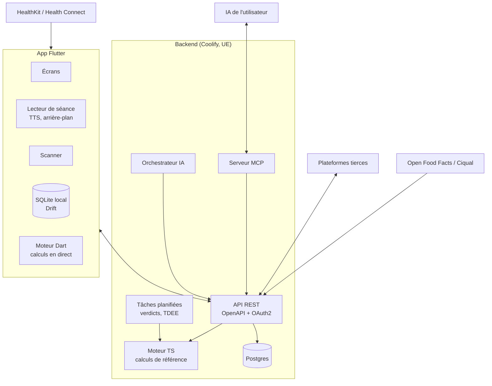

# Architecture

## Principes

1. **L'API d'abord** : l'app mobile est un client de l'API publique, comme l'IA et les plateformes tierces.
2. **Le moteur calcule, l'IA propose** : les formules de [CALCULS.md](../science/CALCULS.md) sont dans un package pur, testé, partagé. Le LLM appelle ces outils et ne calcule jamais lui-même ([ADR-0002](decisions/0002-moteur-deterministe.md)).
3. **Hors ligne d'abord** : séances, saisies et minuteurs fonctionnent sans réseau ; synchronisation ensuite ([ADR-0003](decisions/0003-hors-ligne-dabord.md)).
4. **Règles versionnées et sourcées** : chaque règle a un identifiant, une version, des sources et un niveau de preuve.

## Vue d'ensemble



## Stack

### Mobile (comme dym)
- Flutter, SDK épinglé par **FVM**, monorepo **Melos** avec pub workspaces
- Packages par couche : `foundation` / `infra` / `domain` / `data` / `ui` / `features`, plus les apps
- **Stacked** (routes, injection) + `build_runner`
- `very_good_analysis`, tests unitaires, widget et golden
- Thème généré depuis des tokens de design
- Base locale **Drift** (SQLite), synchronisation avec l'API
- `health` (HealthKit / Health Connect), `mobile_scanner`, `flutter_tts` + `audio_service` (lecteur en arrière-plan), Rive (animations d'exercices), graphiques
- RevenueCat (abonnements)

> Choix des bibliothèques mobiles à confirmer en spec ; la base reprend les conventions de dym.

### Backend (comme struo)
- **Node 22 + TypeScript**, pnpm workspaces, Vitest
- **Postgres**, migrations au démarrage
- **Une image Docker** pour tous les environnements, déployée sur **Coolify** chez un hébergeur UE ; configuration et secrets par variables d'environnement
- Serveur **MCP** intégré au backend (comme struo)

### Le moteur en double (Dart et TS)
Le lecteur de séance a besoin des calculs hors ligne (charge suivante, e1RM), et le serveur en a besoin pour les verdicts et l'API. Les deux implémentations sont validées par **un même jeu de cas de test** (fichiers JSON d'entrées et sorties attendues dans `engine-spec/`), exécuté des deux côtés en CI. La référence est la version serveur.

## Structure du dépôt (cible)

```
cresco/
├─ apps/
│  ├─ cresco_app/          # app Flutter
│  └─ server/              # backend TS (API, MCP, jobs)
├─ packages/
│  ├─ foundation/  infra/  domain/  data/  ui/  features/   # packages Flutter
│  ├─ cresco_engine/       # moteur Dart
│  └─ engine-ts/           # moteur TS
├─ engine-spec/            # cas de test partagés des calculs
├─ docs/
└─ specs/                  # specs par fonctionnalité (spec-kit, comme dym et struo)
```

## Lecteur de séance

- Modèle en **blocs → étapes** (voir [MODELE_DONNEES.md](MODELE_DONNEES.md))
- Moteur d'horloge indépendant de l'écran : service au premier plan (Android), session audio en arrière-plan (iOS)
- Annonces : préavis configurable (par défaut 15 s), voix + vibration + bip
- Tout est enregistré localement à chaque étape (aucune perte si l'app est tuée)

## Sécurité

OAuth2 (PKCE pour l'app, clients tiers enregistrés), permissions par domaine (voir [API_MCP.md](API_MCP.md)), chiffrement au repos des données sensibles, journal des accès tiers.
