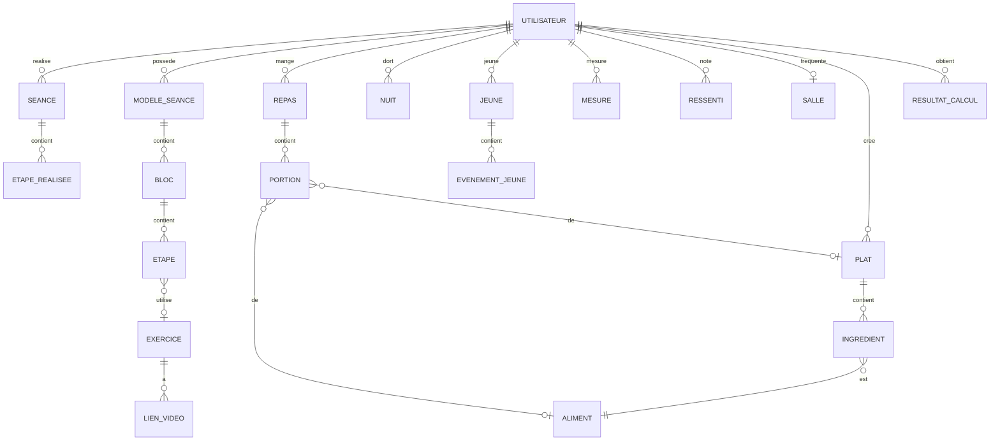

# Modèle de données

Version de conception : les noms et champs définitifs seront fixés dans la spec de fondation.

## Entités



| Entité | Champs principaux |
|---|---|
| `utilisateur` | profil (âge, sexe, taille), niveau, objectif, préférences (module foi, priorité spirituelle, unités, jour de repos verrouillé), consentements |
| `exercice` | nom, muscles primaires et secondaires, matériel, schéma de mouvement, consignes, animation par défaut, `liens_video[]` (ajoutés par l'utilisateur) |
| `salle` | nom, matériel disponible, pas de charge par machine |
| `modele_seance` | nom, type (muscu, course, vélo, HIIT…), blocs |
| `bloc` | ordre, répétitions, étapes |
| `etape` | durée (temps, distance, reps, validation), cible (vitesse, allure, zone FC, charge, RIR, RPE), repos, libellé |
| `seance` | date, modèle d'origine, décision appliquée (`C-AJUST`, `J-DECISION`), RPE de séance, durée, sRPE |
| `etape_realisee` | reps, charge, RIR, vitesse, FC, durée réelle, e1RM calculé |
| `aliment` | source (OFF, Ciqual, perso), code-barres, nutriments pour 100 g |
| `plat` | nom, ingrédients (aliment + masse crue), masse cuite, nutriments calculés (`C-ENERGIE-9`), créé par (utilisateur, IA) |
| `repas` | date, type, portions (aliment ou plat + masse) |
| `nuit` | coucher, lever, temps dormi, phases, efficacité, source |
| `jeune` | type, motif, intention, début, fin prévue, fin réelle |
| `evenement_jeune` | horodatage, type (eau, électrolytes, symptôme, clarté, ressenti spirituel), valeur |
| `mesure` | poids, tour de taille, masse grasse, VFC, FC repos, source |
| `ressenti` | énergie 1–5, courbatures, notes |
| `resultat_calcul` | identifiant de règle, version, entrées (référence), sortie, confiance, sources |
| `parametre_personnel` | poids recalibrés (`C-CALIB`, `J-EFFET`), version |

## Format d'une séance (blocs et étapes)

Exemple : intervalles sur tapis.

```json
{
  "type": "course_tapis",
  "nom": "6 × 1 min rapide",
  "blocs": [
    { "repeter": 1, "etapes": [
      { "duree": { "temps_s": 300 }, "cible": { "vitesse_ms": 2.22 }, "libelle": "Échauffement" } ] },
    { "repeter": 6, "etapes": [
      { "duree": { "temps_s": 60 }, "cible": { "vitesse_ms": 3.89 }, "libelle": "Rapide" },
      { "duree": { "temps_s": 90 }, "cible": { "vitesse_ms": 2.5 },  "libelle": "Récupération" } ] }
  ],
  "annonces": { "preavis_s": 15, "voix": true, "vibration": true }
}
```
(2,22 m/s = 8 km/h ; 3,89 m/s = 14 km/h.)

Exemple : musculation.

```json
{
  "type": "muscu",
  "blocs": [
    { "repeter": 3, "etapes": [
      { "exercice_id": "developpe-couche-barre",
        "duree": { "reps": 8 },
        "cible": { "rir": 2, "charge_kg": "auto" },
        "repos_s": 150 } ] }
  ]
}
```
`"charge_kg": "auto"` : calculée par `C-PERF-3` au moment de la séance.

## Résultat de calcul (traçabilité)

```json
{
  "regle": "C-AJUST",
  "version": 1,
  "sortie": { "volume": -0.2, "decision": "ADAPTEE" },
  "confiance": "moyenne",
  "niveau_preuve": "H",
  "sources": ["S-21", "S-22"],
  "explication": "Score de forme 62 : sommeil court (5 h 50) et VFC sous ta moyenne."
}
```
