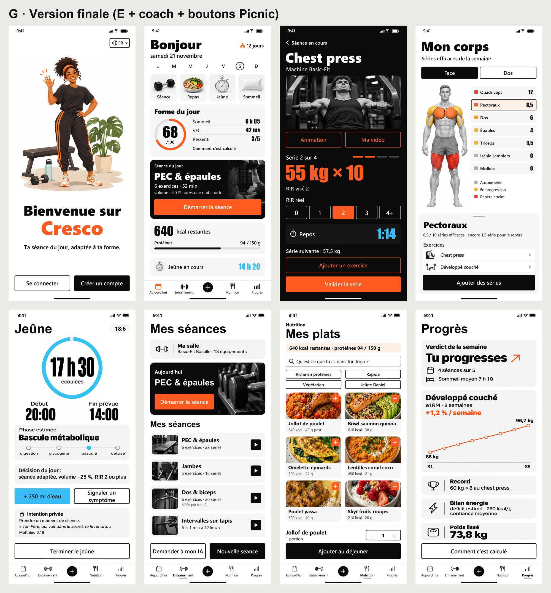

# Design de Cresco

Design validé le 21 novembre 2026 : **direction G « Net et braise »**, avec les coachs illustrés et les formes de Picnic. Il remplace le design « noir et citron vert » validé plus tôt le même jour. Le chemin qui y mène, avec les sept directions explorées, est dans [propositions-v2/README.md](propositions-v2/README.md). La décision est consignée dans l’[ADR-0004](../architecture/decisions/0004-design-net-et-braise.md).

## Principe

Clair et direct au quotidien, électrique quand on s’entraîne.

- **Au quotidien** (Aujourd’hui, Nutrition, Progrès, Jeûne), on suit Cal AI et Uber : noir sur blanc, hiérarchie forte, listes nettes, une seule action principale par écran, bouton principal en bas.
- **Pendant l’effort** (Séance en cours), on suit l’énergie de « Nuit et braise » : écran sombre lisible à un mètre, chiffres d’affiche en braise, repos en bleu glacier.
- **Les coachs** apportent la chaleur de Picnic : ils accueillent, expliquent et encouragent, mais n’apparaissent jamais pendant l’effort.
- Une carte = une idée. Le chiffre qui compte est grand, sa cause est écrite juste en dessous, et « Comment c’est calculé » est toujours à un toucher.

## Couleurs (`CrescoPalette`, `packages/cresco_ui/lib/src/palette.dart`)

| Rôle | Clair | Sombre | Emploi |
| --- | --- | --- | --- |
| `background` | `#FFFFFF` | `#0A0A0A` | Fond des écrans |
| `surface` | `#F6F6F6` | `#161616` | Cartes, champs, tuiles (toujours avec contour) |
| `line` | `#E2E2E2` | `#2A2A2A` | Contours de 1,5 pt, séparateurs |
| `ink` / `muted` | `#0A0A0A` / `#616161` | `#F5F5F5` / `#A3A3A3` | Texte principal / secondaire |
| `action` / `onAction` | `#0A0A0A` / `#FFFFFF` | `#F5F5F5` / `#0A0A0A` | Boutons principaux, « + » |
| `hero` | `#0A0A0A` | `#161616` | Carte « Séance du jour », texte blanc |
| `effort` / `onEffort` | `#FF5A1F` / `#0A0A0A` | idem | **Uniquement l’effort** : démarrer, valider une série, charge, chaleur des muscles, courbe de force |
| `effortSoft` / `onEffortSoft` | `#FFE6DB` / `#8A2A05` | `#3A1A0E` / `#FFD2BF` | Choix sélectionné, pastille de muscle choisi |
| `rest` | `#38BDF8` | idem | **Repos, sommeil, jeûne** : minuteur de repos, cadran du jeûne |
| `restSoft` / `onRestSoft` | `#E3F5FD` / `#075985` | `#0C2A3A` / `#BAE6FD` | Cartes et textes de jeûne |
| `danger`, `warningSoft` | `#C2264A`, `#FFF1D6` | `#FF8FA3`, `#3A2A10` | Erreur, avertissement |

**Contraste.** Le texte sur braise est noir (6,7:1) : du blanc sur `#FF5A1F` ne ferait que 3:1, sous le seuil AA. C’est le seul écart volontaire aux maquettes, où le texte des boutons braise est blanc. Le texte secondaire `#616161` sur blanc atteint 6,2:1.

## Formes : comme Picnic (`CrescoShape`, `packages/cresco_ui/lib/src/theme.dart`)

- **Coins de 4 pt** et **contour fin de 1,5 pt** sur les boutons, cartes, champs, pastilles, sélecteurs (Face/Dos, RIR, portions), lignes de liste, tuiles, vignettes photo et panneaux qui montent du bas.
- Les cartes noires pleines n’ont pas de contour en mode clair.
- **Boutons** : 48 pt de haut ; libellé de 17 pt en graisse normale (comme Picnic), avec une majuscule seulement au premier mot ; aucune ombre. Quand deux boutons vont ensemble, ils sont côte à côte et de même largeur.
  - **Principal** : plein noir (`FilledButton`).
  - **Effort** : plein braise (`effortButtonStyle`).
  - **Secondaire** : contour noir (`OutlinedButton`), ou contour braise sur l’écran de séance.
- **Restent ronds** : le « + » de la barre d’onglets, les anneaux de données (forme, jeûne), les pastilles de légende et les avatars.

## Typographie

- **Inter**, embarquée, pour tout. Titres en 900 avec un interlettrage serré (34 pt pour une page, 24 pt pour une carte) ; chiffres d’affiche en 900, chiffres tabulaires.
- **Barlow Condensed** (OFL, embarquée, graisses 700 et 800) pour les chiffres d’affiche (`CrescoTextes.chiffre`) : durée du jeûne, heures, charges, poids, kcal.
- **Gelasio** (serif) reste réservée à l’intention et au verset du module foi.
- Les unités restent sur la ligne du nombre, en plus petit et en gris. Toutes les tailles suivent le réglage du système ; à 130 %, les grilles passent sur une colonne et la page défile.

## Coachs

- **Deux coachs**, Maya et Karim. Les noms sont proposés et restent à valider. Leur tenue est la même : tee-shirt noir, bas noir à deux bandes braise, baskets blanches et braise, avec un bandeau (Maya) ou un serre-poignet (Karim) braise.
- **Où ils apparaissent**, dans la pose qui convient :
  - l’**accueil** (le duo) ;
  - le **démarrage** : première question « Qui t’accompagne ? », puis le coach choisi pose chaque question dans une bulle ;
  - les **états vides** (Mes séances, éditeur, bibliothèque d’exercices) ;
  - le choix « Mon coach » dans Profil.
- **Où ils n’apparaissent jamais** : séance en cours, intervalles, cadran du jeûne, données de santé.
- **Six poses par coach** : salue, explique, carnet, pouce, réfléchit, célèbre (`CoachPose`).
- Le choix est enregistré dans `preferences.coach` (`femme` ou `homme`), lisible par l’IA, et gardé sur le téléphone pour l’affichage hors ligne (`apps/cresco_app/lib/ui/coach.dart`).

## Logo

Direction A, choisie le 22/11/2026 parmi six propositions générées avec ChatGPT ([propositions](logo/propositions/)) : un « C » épais en braise dont l’extrémité basse monte en trois marches, sur un carré d’encre. « Cresco » veut dire « je grandis » : le progrès pas à pas.

- Sources **SVG écrites à la main** et générées par [logo/generer.py](logo/generer.py) : `logo-icone.svg`, `logo-symbole.svg` (le C seul), `logo-horizontal.svg` et `logo-horizontal-blanc.svg` (avec « cresco » en Barlow Condensed ExtraBold vectorisée), `logo-monochrome.svg`.
- `python -I docs/design/logo/generer.py --png` produit les icônes Android (classiques et adaptatives, 48 à 192 px), l’icône iOS 1024 px, l’image de lancement et `assets/logo/icone.png` (`CrescoLogo`, écran de bienvenue).
- Lancement : le C seul au centre, sur fond d’encre.

## Mon corps

- Corps anatomique **réaliste en niveaux de gris**, de face et de dos, généré avec ChatGPT et calé sur des cartes à couleurs clés qui donnent un masque par muscle (`BodyMap`) :
  - chaque muscle travaillé prend la teinte de son niveau de séries efficaces de la semaine (règle `C-PERF-5`, repère de 10), posée sur le modelé du rendu (mode « couleur » après un assombrissement léger) ; un muscle sans série garde les gris du corps ; le short n’est jamais teinté ;
  - le muscle choisi est entouré d’un contour à l’encre ;
  - une carte des zones à un quart de la résolution dit quel muscle est sous le doigt.
- Échelle : gris (rien cette semaine), puis de l’ambre `#FFE0B3` → `#FFB020` → `#FF7A2A` jusqu’au rouge braise `#E8341C` (repère atteint).
- La progression et la récupération par muscle ne sont pas encore des règles du moteur. Elles doivent être spécifiées dans [CALCULS.md](../science/CALCULS.md), avec leurs cas dans `engine-spec/`, avant d’être affichées.

## Médias

Tous les médias viennent de ChatGPT (via Codex). Leur fabrication, leur inventaire et la façon de les régénérer sont décrits dans [medias/README.md](medias/README.md). Dans l’app, ils passent par `packages/cresco_ui/lib/src/media.dart` :

| Composant | Contenu |
| --- | --- |
| `CoachIllustration`, `CoachDuo` | Les poses des coachs et le duo d’accueil |
| `ShortcutIconImage` | Les icônes 3D des raccourcis |
| `CrescoPhotoImage` | Les photos en noir et blanc, choisies selon l’exercice |

## Écrans

| Écran | Points clés |
| --- | --- |
| Bienvenue | Duo, « Bienvenue sur Cresco », « Se connecter » et « Créer un compte » côte à côte |
| Démarrage | 5 étapes : coach, objectif, rythme et jours de repos, Ma salle, jeûne et foi |
| Aujourd’hui | Série de jours actifs (pastille flamme « 12 jours ») et accès au profil en haut ; date et bandeau des jours (lettres simples, aujourd’hui cerclé, point braise sous les jours entraînés) ; tuiles Séance, Repas, Jeûne, Sommeil ; anneau de forme braise ; carte noire de la séance du jour avec un seul bouton braise ; énergie avec barre de protéines noire ; jeûne ; Mon corps |
| Séance en cours | Toujours sombre ; nom, matériel, photo ; « Consignes » et « Ma vidéo » en contour braise ; « Série x sur y » avec barres ; charge × répétitions en grands chiffres braise ; RIR en rectangles ; repos en glacier ; « Ajouter un exercice » et « Valider la série » fixés en bas |
| Entraînement (Mes séances) | Titre « Mes séances » ; carte « Ma salle » (pictogramme, séparateur, salle et nombre d’équipements) ; carte noire du jour ; séances et intervalles en lignes avec vignette et bouton lecture noir ; en bas « Demander à mon IA » (explique le MCP) et « Nouvelle séance » |
| Ma salle | Nom, chaîne, puis chaque équipement en carte photo (deux par ligne, une seule en grand texte) : coché = contour noir épais et coche noire, sinon photo atténuée ; bouton noir « ▶ Mouvement » en bas à gauche de la photo quand le coach a ses poses : feuille où Karim montre le mouvement en boucle (départ, milieu, fin, 2,4 s), avec une puce par exercice pour un poste qui en a plusieurs (poulies, Smith…) ; le même coach remplace la démonstration en séance |
| Mon corps | Titre et sous-titre ; muscles triés du plus travaillé au moins travaillé, légende sous la liste, le tout à côté du corps ; Face/Dos ; corps et liste des muscles visibles ; légende ; fiche du muscle : séries / repère et ce qu’il manque sur une ligne, exercices de la salle qui le travaillent, « Ajouter des séries » (ouvre l’éditeur avec l’exercice), « Comment c’est calculé » |
| Jeûne | Cadran glacier, début et fin prévue, phase estimée avec la frise des phases (`J-PHASE`), décision du jour, « + 250 ml d’eau » (glacier) et « Signaler un symptôme » côte à côte, intention et verset, « Terminer le jeûne » |
| Nutrition (« Mes plats ») | Reste du jour (kcal, protéines), recherche « Qu’est-ce que tu as dans ton frigo ? » avec le scan, quatre filtres 2 × 2, grille de plats en photos avec « + » braise, panneau de portion (grammes − +, « Ajouter au déjeuner » selon l’heure) |
| Progrès | Verdict de la semaine (flèche braise quand tu progresses, séances de la semaine, sommeil moyen), force estimée sur 8 semaines et sa courbe en braise (valeurs de départ et d’arrivée, S1 à S8), record, bilan énergie, poids lissé, « Comment c’est calculé » |
| Barre d’onglets | Aujourd’hui (calendrier), Entraînement (barre à disques horizontale), « + » rond noir de 40, Nutrition, Progrès ; pictogrammes Phosphor noirs (trait normal, gras pour l’onglet actif), libellés noirs, onglet actif en gras et souligné de noir ; la braise reste réservée à l’effort. Visible sous **toutes** les pages ouvertes depuis un onglet (Mon corps, Ma salle, Jeûne, Profil, éditeur…), l’onglet d’origine restant souligné ; toucher un onglet ramène à sa page. Cachée seulement pendant l’effort (Séance en cours, Intervalles), le scan, la connexion et le démarrage, et quand le clavier est ouvert (`lib/ui/tabs.dart`) |

Les photos de plats viennent de neuf familles générées avec ChatGPT ([medias/plats](medias/plats/NOTES.md)) ; l’app choisit la famille d’après le nom du plat. Les filtres de « Mes plats » lisent les étiquettes enregistrées sur le plat (`tags` : proteines, rapide, vegetarien, daniel), posées par l’utilisateur ou son IA ; rien n’est deviné.

## Mouvement

- **Entrée des cartes** : montée de 18 pt et fondu, 0,52 s, cartes décalées de 70 ms.
- **Anneaux** : ils se remplissent à l’ouverture.
- **Étapes du démarrage** : glissement horizontal.
- **Face/Dos** : fondu.
- **Réduction des animations** : respectée partout, tout devient statique.

## États obligatoires

Chaque écran qui charge des données prévoit quatre états, communs à toute l’app (`states.dart`) :

1. **Vide** : le coach dans une pose adaptée, une phrase qui dit quoi faire, une action principale et parfois une secondaire.
2. **Chargement** : des squelettes à la forme des cartes.
3. **Erreur** : ce qui s’est passé, le rappel que rien n’est perdu, et « Réessayer ».
4. **Hors ligne** : un bandeau, et la séance reste possible.

## Pictogrammes

Pictogrammes de ligne **Phosphor** (licence MIT), polices embarquées dans `cresco_ui` et exposées par `CrescoIcons` : trait normal par défaut, gras pour un état actif. On ajoute une icône à `CrescoIcons` plutôt que de mélanger les jeux sur un écran. Le paquet `phosphor_flutter` n’est pas utilisé : il étend `IconData`, devenue `final` dans Flutter.
