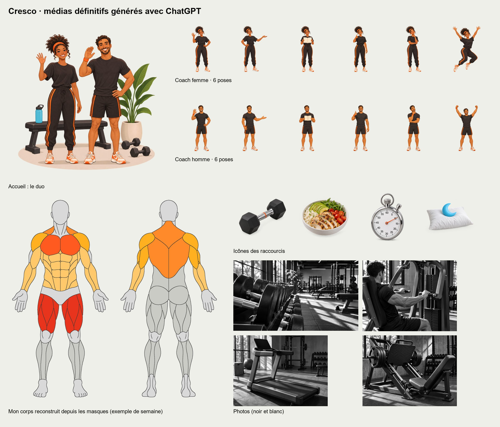

# Médias de Cresco

Tous les médias de l’app ont été **générés avec ChatGPT** (outil de génération d’images de Codex, compte ChatGPT de l’utilisateur), le 21 novembre 2026, après validation du design G.



## Inventaire

| Lot | Consigne | Utilisé dans l’app | Taille |
| --- | --- | --- | --- |
| Coach femme (Maya) : planche de référence et 6 poses | [coach-femme/BRIEF.md](coach-femme/BRIEF.md) | `packages/cresco_ui/assets/coach/femme-<pose>.png` | 640 px, palette de 256 couleurs |
| Coach homme (Karim) : planche de référence et 6 poses | [coach-homme/BRIEF.md](coach-homme/BRIEF.md) | `assets/coach/homme-<pose>.png` | idem |
| Duo d’accueil | [accueil-duo/BRIEF.md](accueil-duo/BRIEF.md) | `assets/coach/duo.png` | 1024 px |
| Corps complet, face et dos | [corps/BRIEF.md](corps/BRIEF.md) | `assets/body/` (calque de base, un masque par muscle, carte des zones) | 1024 × 2048, environ 330 Ko en tout |
| Icônes 3D (séance, repas, jeûne, sommeil) | [icones-photos/BRIEF.md](icones-photos/BRIEF.md) | `assets/icons/` | 384 px |
| Photos des 9 familles de plats | [plats/BRIEF.md](plats/BRIEF.md), [notes](plats/NOTES.md) | `assets/dishes/` | 900 px, JPEG |
| Photos noir et blanc (salle, chest press, tapis, presse à cuisses) | idem | `assets/photos/` | 1200 px, JPEG |

Les poses sont : `salue`, `explique`, `carnet`, `pouce`, `reflechit`, `celebre`. Chaque dossier contient la consigne envoyée (`BRIEF.md`) et la note de ChatGPT (`NOTES.md`). Les planches de référence des coachs sont en JPEG dans leur dossier.

## Fabrication

1. **Générer** un lot :

   ```powershell
   pwsh docs/design/medias/run-media.ps1 <lot> <images de référence…>
   ```

   La consigne passe par l’entrée standard (l’option `-i` de Codex accepte plusieurs fichiers et avalerait la consigne).
   - Les deux coachs ont été générés à partir des maquettes G.
   - Le duo a été généré à partir des **deux planches de référence**, pour garder les mêmes visages.
2. **Découper le corps** :

   ```powershell
   python docs/design/medias/corps/extraire.py
   ```

   - Le corps a été dessiné avec une **couleur clé exacte par groupe de muscles** (tableau dans la consigne). Le script en tire :
     - un calque de base (contours et peau, sur fond transparent) ;
     - un masque blanc par muscle, que l’app teinte ;
     - une carte des zones à un quart de la résolution (valeur du pixel = index du muscle + 1, dans l’ordre de `BodyMuscles.all`).
   - `face.png` et `dos.png`, avec leurs couleurs clés exactes, sont gardés pour pouvoir refaire ce découpage.
3. **Préparer les médias de l’app** :

   ```powershell
   python docs/design/medias/preparer_assets.py
   ```

   - Le script redimensionne et allège les médias (palette de 256 couleurs pour les illustrations, JPEG pour les photos), puis les copie dans `packages/cresco_ui/assets/`.
   - Il archive ensuite les planches en JPEG et supprime les PNG bruts.
   - Les fichiers de `assets/` font désormais référence.
4. **Planche récapitulative** :

   ```powershell
   python docs/design/medias/recapitulatif.py
   ```

   Ce script utilise les PNG bruts, à lancer avant l’étape 3.

## Règles

- **Les coachs n’apparaissent jamais pendant l’effort.** Une nouvelle pose se génère avec les deux planches de référence jointes, pour garder les mêmes traits.
- **Un nouveau muscle** demande une nouvelle couleur clé. Il faut alors l’ajouter dans `extraire.py`, dans `BodyMuscles` et dans `muscleNames`, puis relancer le découpage.
- **Aucune marque réelle** ni personne reconnaissable dans les médias.
- **Médias manquants** : une animation par exercice et l’icône de l’app.
