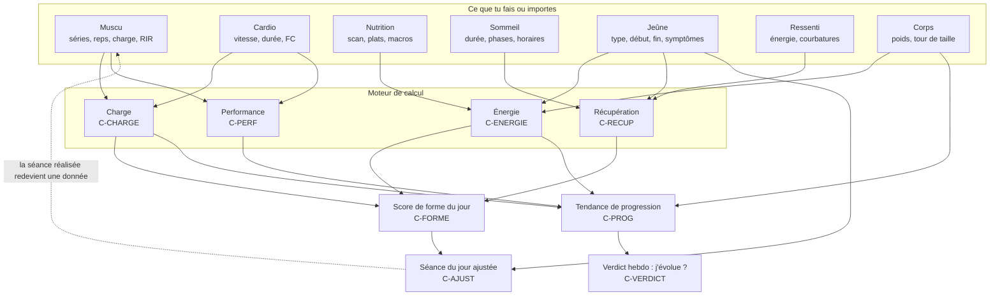
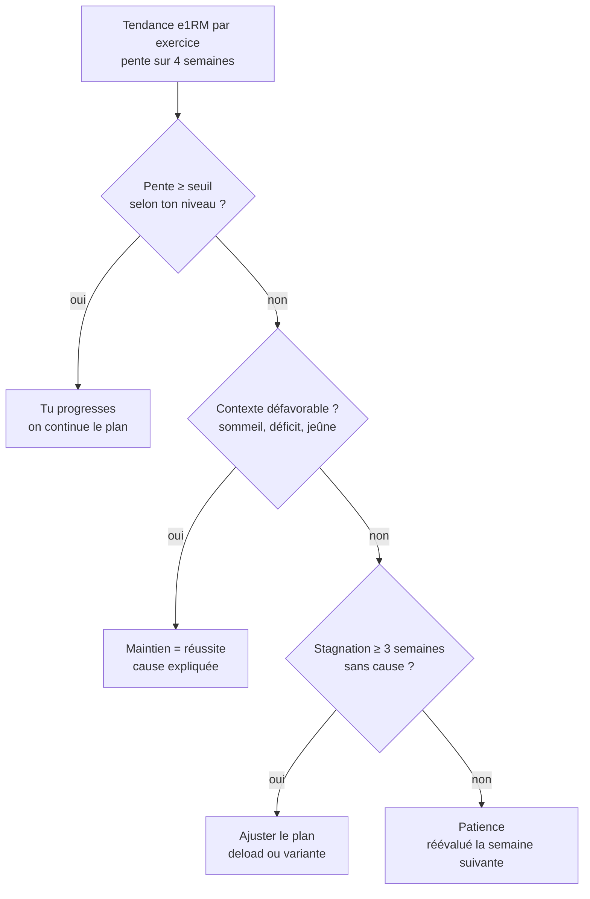
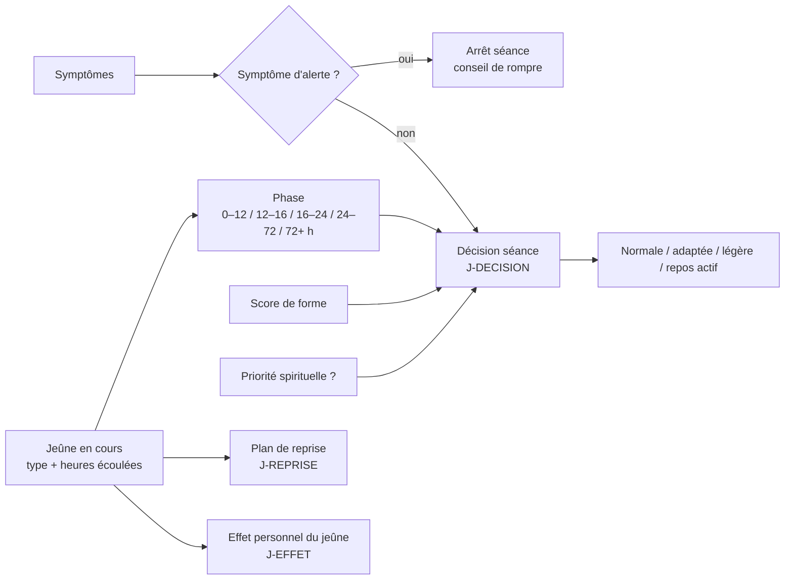

# Liens entre les données

Ce document montre **comment chaque donnée saisie ou importée influence les calculs**, et donc la séance du jour et le verdict de progression. Les formules sont dans [CALCULS.md](CALCULS.md), et chaque bloc renvoie à son identifiant (`C-…`).

## 1. Vue d'ensemble

## 2. Une journée type

| Moment | Ce que tu fais | Ce que l'app calcule |
|---|---|---|
| Réveil | Rien (import auto) + ressenti en 1 tap | Score sommeil, VFC et FC repos vs ta référence, **score de forme** |
| Avant séance | Tu ouvres la séance | **Séance ajustée** (volume, charges, RIR cible), règles jeûne si un jeûne est en cours |
| Pendant | Tu valides chaque série et son RIR | **Charge de la série suivante**, e1RM en direct |
| Après | RPE de la séance | **sRPE**, e1RM retenu par exercice, volume efficace |
| Repas | Scan, plat favori ou dictée à l'IA | Kcal et macros vs cibles, protéines par repas |
| Soir | Rien | **Bilan énergie** du jour ; nuit suivante → score du lendemain |
| Dimanche | Rien (pesée et tour de taille conseillés) | **Verdict hebdomadaire**, TDEE adaptatif recalculé |

## 3. Le verdict « est-ce que j'évolue ? »

Le verdict est croisé avec la composition corporelle (voir `C-VERDICT`). La force seule ne dit pas tout.

## 4. Le jeûne dans le système

Détail dans [JEUNE.md](JEUNE.md).

## 5. Qui dépend de quoi

| Calcul | Dépend de | Influence |
|---|---|---|
| `C-PERF` (e1RM, volume) | Séries muscu | `C-PROG`, `C-AJUST` (charges cibles) |
| `C-CHARGE` (sRPE, TRIMP, aigu/chronique) | Muscu, cardio | `C-FORME`, `C-PROG` (contexte) |
| `C-RECUP` (sommeil, VFC, FC repos) | Sommeil, capteurs, jeûne | `C-FORME`, `C-VERDICT` (contexte) |
| `C-ENERGIE` (bilan, TDEE, macros) | Nutrition, poids, jeûne | `C-FORME`, `C-VERDICT` (contexte) |
| `C-FORME` | Récupération, charge, énergie, ressenti, jeûne | `C-AJUST` |
| `C-PROG` | Performance + contexte | `C-VERDICT` |
| `J-DECISION` | Jeûne, forme, symptômes, préférence | Séance du jour (prioritaire sur `C-AJUST`) |
| `J-EFFET` | Jours de jeûne vs jours normaux | Rapport personnel, recalibrage |

**Ordre de priorité des règles** : sécurité (symptômes) > jour de repos verrouillé > jeûne (`J-DECISION`) > score de forme (`C-AJUST`) > plan.
